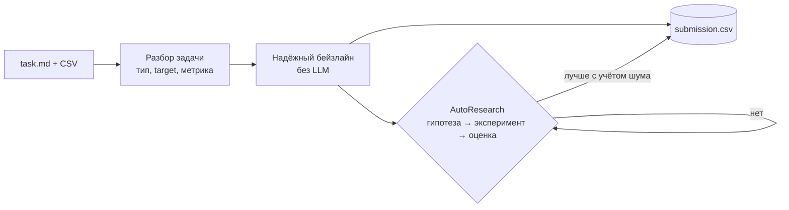

# alfahack-automl

**AI-агент, который сам решает ML-задачи на табличных данных**: читает описание задачи, изучает данные, строит надёжный бейзлайн, затем в цикле AutoResearch выдвигает и проверяет гипотезы и сдаёт `submission.csv`. Без ручной настройки под конкретный датасет.

Кейс Альфа Хак «AI-агент для разработки ML-моделей» (Альфа-Банк × Changellenge). Условия — [reference/case_alfahack_automl.pdf](reference/case_alfahack_automl.pdf).


## Как это работает



Главный принцип — **«сначала надёжно, потом умно»**: валидный ответ появляется в первые минуты, LLM только улучшает его. Подробно — [docs/architecture.md](docs/architecture.md), почему так — [docs/decisions/](docs/decisions/).

## Быстрый старт

Новичок в команде? Начни с **[ONBOARDING.md](ONBOARDING.md)** — путь на 1 час.

```
gh repo clone alfahack-ilove4fak/alfahack-automl && cd alfahack-automl
uv sync
uv run python scripts/install_hooks.py
uv run python scripts/doctor.py --role <captain|agent|ml|research|qa>
uv run python solution.py tasks/public/regression/task.md
```

| Команда | Что делает |
|---|---|
| `uv run pytest` | все тесты: контракты, юнит, дымовой прогон агента |
| `uv run ruff check .` | стиль и типичные ошибки |
| `uv run python scripts/run_local.py --all --minutes 5 --mock-llm` | агент на всех задачах, без LLM |
| `uv run python scripts/package_submission.py` | ZIP для платформы в `dist/` |
| `uv run python scripts/doctor.py --role <роль>` | проверка готовности рабочего места |

## Где что лежит

| Путь | Что это | Владелец |
|---|---|---|
| `solution.py` | точка входа платформы | captain |
| `interfaces/` | контракты между модулями | captain |
| `runtime/` | бюджет времени/памяти/₽, логи | captain |
| `agent/` | разбор задачи, LLM, гипотезы, цикл | agent |
| `ml/` | данные, модели, кросс-валидация | ml |
| `evaluation/` | метрики, проверка сабмита, харнесс | qa |
| `research/` | playbook гипотез, исследования | research |
| `tasks/public/` | две публичные задачи в формате платформы | — |
| `reference/` | файлы организаторов без изменений | — |
| `docs/` | вся документация команды | все |

## Документация

| Для чего | Файл |
|---|---|
| Онбординг за час | [ONBOARDING.md](ONBOARDING.md) |
| Установка по ОС | [docs/install.md](docs/install.md) |
| Настройка Claude Code | [SETUP_CLAUDE.md](SETUP_CLAUDE.md) |
| Правила работы с кодом | [CONTRIBUTING.md](CONTRIBUTING.md) |
| Git в нашем репозитории | [docs/git-guide.md](docs/git-guide.md) |
| Ритм команды и стыковки | [docs/team-process.md](docs/team-process.md) |
| Чек-поинты CP0–CP5 | [docs/checkpoints.md](docs/checkpoints.md) |
| **План до 27.10 по ролям (обновлён 22.10 вечером)** | [docs/final-sprint.md](docs/final-sprint.md) |
| Состав команды и статусы | [docs/team.md](docs/team.md) |
| Ролевые пакеты | [docs/roles/](docs/roles/) |
| Проверенные материалы | [docs/resources/](docs/resources/) |
| Глоссарий | [docs/glossary.md](docs/glossary.md) |
| Журналы: эксперименты, сабмиты, решения | [docs/experiments.md](docs/experiments.md), [docs/submissions.md](docs/submissions.md), [docs/decisions/](docs/decisions/) |

## Ветки

`main` — стабильная, каждый сабмит — тег · `dev` — интеграция (по умолчанию) · `team/<имя>` — личная ветка с `START_HERE.md` · `<роль>/<задача>` — задачи. Правила — [CONTRIBUTING.md](CONTRIBUTING.md).
