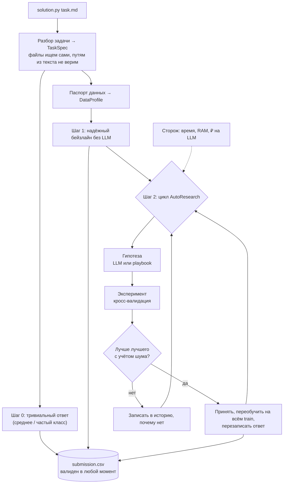
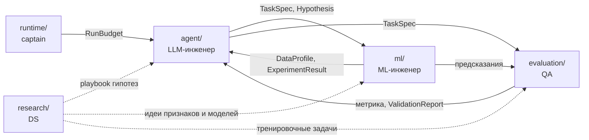

# Архитектура

## 1. Что делает агент

На платформу уходит ZIP с `solution.py`. Платформа запускает его отдельно на каждой задаче:
`python3 solution.py task.md` в каталоге задачи (+ переменные `OPENAI_API_KEY`, `OPENAI_MODEL`, `OPENAI_BASE_URL`).
За **3 часа** на машине **8 CPU / 32 ГБ, без интернета** агент должен положить `submission.csv` рядом с `task.md`.
Итоговое место решают **две скрытые задачи** с неизвестными заранее данными и метрикой.

Стратегия — **«сначала надёжно, потом умно»**:



Почему так:
- Балл = 0, если не лучше бейзлайна организаторов. Значит, сначала гарантируем хороший ответ, потом улучшаем.
- LLM (Qwen) может ошибаться, отвечать медленно или быть недоступной — агент обязан работать и без неё.
- На скрытых задачах запустят версию с **лучшим public score** — поэтому никаких «хаков» под публичные задачи: всё, что попадает в агента, должно быть полезно на любой табличной задаче.
- Платформа не даёт обратной связи во время запуска — агент сам оценивает себя честной кросс-валидацией.

### Шаг 2: Qwen — инженер данных (главная роль LLM, 26.10)

После бейзлайна (`solution.py` → `agent/data_engineer.py`):
1. Qwen читает условие задачи, профиль данных и карточки колонок (тип, доля пропусков, число значений, примеры).
2. Отвечает планом: что сделать с данными и зачем, код `prepare(df)` (какие колонки оставить, как почистить, какие признаки добавить), модель из готовых (`lightgbm`, `catboost`, `xgboost`, `hist_gb`, `linear`, `random_forest`, `extra_trees`) и её параметры.
3. Код выполняется в песочнице; агент считает CV на подготовленных данных — та же схема и те же фолды, что у бейзлайна. Ошибка или результат возвращаются Qwen: до 3 раундов, Qwen может остановиться сам.
4. Qwen выбирает вариант для ответа и пишет вывод (`qwen_report.md`, `agent.log`). Выбор хуже бейзлайна больше шума CV агент не берёт.
5. Выбранные данные и модель записываются в ответ и становятся основой цикла AutoResearch.

Без ключа, при сбое LLM или мусорном ответе — путь как раньше (бейзлайн → цикл). `AGENT_DATA_ENGINEER=0` выключает шаг.

## 2. Модули и владельцы

| Папка | Что внутри | Владелец |
|---|---|---|
| `solution.py` | Точка входа: склеивает модули, гарантирует ответ | captain |
| `interfaces/` | Контракты: схемы данных, сигнатуры, заглушки | captain (меняется по процессу) |
| `runtime/` | Бюджет времени/RAM/₽, логи, песочница для кода LLM | captain |
| `agent/` | Разбор задачи, LLM-клиент, гипотезы, цикл AutoResearch | agent |
| `ml/` | Профиль данных, признаки, модели, CV, финальное обучение | ml |
| `evaluation/` | Реестр метрик, проверка сабмита, локальный скор, харнесс | qa |
| `research/` | Playbook гипотез, исследования в ноутбуках | research |
| `tasks/` | Публичные задачи + тренировочные «скрытые» задачи | research + qa |
| `scripts/` | doctor, хуки, упаковка, запуск, подключение участника | qa (+ captain) |
| `tests/` | Контракты, юнит, дымовые прогоны | qa (каждый пишет тесты к своему коду) |

На платформу уезжают только `solution.py`, `interfaces/`, `runtime/`, `agent/`, `ml/`, `evaluation/` и `research/playbook.yaml` (собирает `scripts/package_submission.py`).

## 3. Контракты: кто что кому передаёт



| Контракт | Создаёт → читает | Суть |
|---|---|---|
| `TaskSpec` | agent → все | найденные пути к файлам, тип задачи, target, id, метрика и её направление, колонки сабмита, классы |
| `DataProfile` | ml → agent | размеры, числовые/категориальные признаки, пропуски, распределение target, предупреждения |
| `Hypothesis` | agent → ml | вид, обоснование, `params` (модель, гиперпараметры, преобразования), опционально код |
| `ExperimentResult` | ml → agent, evaluation | скоры по фолдам, среднее и разброс, время, память, ошибка |
| `RunBudget` | runtime → все | сколько осталось времени, лимит RAM, рубли на LLM |
| `ValidationReport` | evaluation → runtime | валиден ли `submission.csv` и что не так |

Код — [interfaces/schemas.py](../interfaces/schemas.py), сигнатуры функций — [interfaces/protocols.py](../interfaces/protocols.py), заглушки — [interfaces/stubs.py](../interfaces/stubs.py). Изменения — только по CONTRIBUTING.md, раздел 5.

## 4. Как запустить

```
uv run python solution.py tasks/public/regression/task.md
```
Быстрая проверка (10 минут, без LLM): в `.env` поставь `AGENT_TIME_BUDGET_SEC=600` и `LLM_MOCK=1`.
Ответ появится в `tasks/public/regression/submission.csv`, лог — в `runs/latest/agent.log`.

## 5. Важные факты о платформе

| Факт | Источник |
|---|---|
| ZIP, в корне `solution.py`; интерфейс как в `reference/baseline.py` | PDF кейса, с. 6 |
| **В каталог задачи копируются только корневые `.py` и `requirements.txt`** — папки теряются. Поэтому `scripts/package_submission.py` собирает самораспаковывающийся `solution.py` (код агента внутри, распаковка в `/tmp`), проверка — `tests/smoke/test_package.py` | `reference/platform_instructions.md`, ADR 0007 |
| Запуск: `python3 solution.py task.md`, рабочая папка = папка с `task.md`; временные файлы — там же или в `/tmp`; ZIP ≤ 100 МБ; свой `pip` запускать нельзя | `reference/platform_instructions.md` |
| Docker, 8 CPU, 32 ГБ, без интернета, Python 3.12, только `requirements.txt` | с. 7 |
| 3 часа на задачу, после — принудительная остановка | с. 7, 17 |
| LLM — только Qwen через выданный ключ; 600 ₽/день на команду **только на время разработки** | с. 7, `reference/organizer_chat_faq.md` |
| ✅ **На платформе лимита на вызовы и токены нет** (только время скрипта); запуски на платформе в 600 ₽ не входят. `LLM_RUB_LIMIT` на платформе не задан → 0 → без ограничения (это нужно для локальных прогонов) | чат организаторов |
| ✅ Ключ приходит капитану на почту; остаток — `GET https://changellenge.up.railway.app/key/info` с `Authorization: Bearer <ключ>`; цена токена не названа | чат организаторов |
| ✅ Две задачи идут **параллельно**, по 3 часа на каждую, в разных каталогах; private и public считаются отдельно, каждое — среднее двух задач | чат организаторов |
| ✅ В контейнере нет `git` и нет пакета `mcp`; диск ≈ 30–35 ГБ; данные только текстовые/табличные | чат организаторов |
| 3 сабмита в день, сброс в 00:00 МСК | с. 6 |
| Балл задачи = 100·max(0, улучшение над бейзлайном); public = среднее двух задач | с. 18–19 |
| На private берётся версия с лучшим public score | с. 16 |
| ✅ Точка входа — `solution.py` (в приложении 2 PDF `script.py` — опечатка) | `reference/platform_instructions.md` |
| ✅ `baseline.py` импортирует `mcp`, но в контейнере его нет — организаторы подтвердили. В своём коде `mcp` не используем: инструменты для модели даёт сам скрипт | чат организаторов |
| ⚠️ Не выяснено: точное время окончания приёма сабмитов, формат защиты и питча, цена токена Qwen | задача C-L1-2 |
