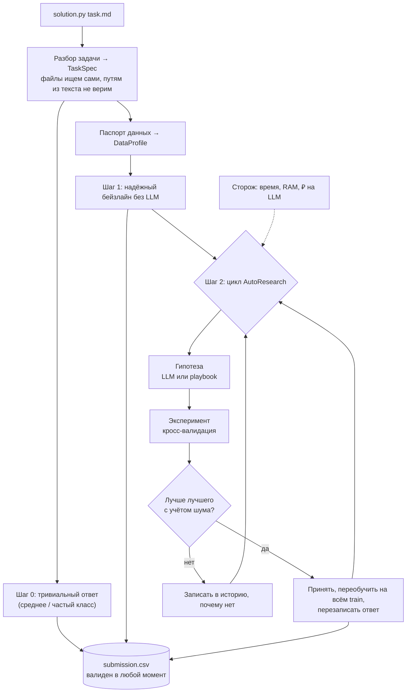
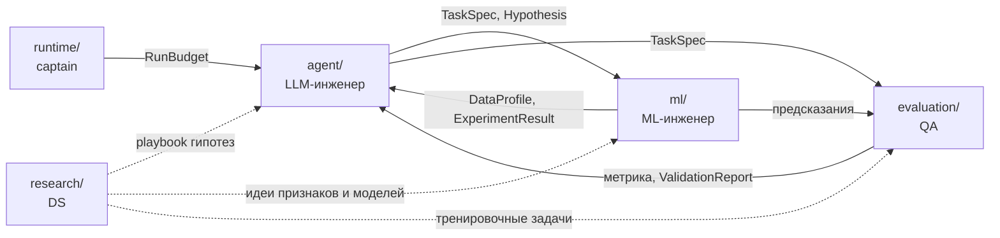

# Архитектура

## 1. Что делает агент

На платформу уходит ZIP с `solution.py`. Платформа запускает его отдельно на каждой задаче:
`python solution.py <путь>/task.md` (+ переменные `OPENAI_API_KEY`, `OPENAI_MODEL`, `OPENAI_BASE_URL`).
За **3 часа** на машине **8 CPU / 32 ГБ, без интернета** агент должен положить `submission.csv` рядом с `task.md`.
Итоговое место решают **две скрытые задачи** с неизвестными заранее данными и метрикой.

Стратегия — **«сначала надёжно, потом умно»**:



Почему так:
- Балл = 0, если не лучше бейзлайна организаторов. Значит, сначала гарантируем хороший ответ, потом улучшаем.
- LLM (Qwen) может ошибаться, отвечать медленно или быть недоступной — агент обязан работать и без неё.
- На скрытых задачах запустят версию с **лучшим public score** — поэтому никаких «хаков» под публичные задачи: всё, что попадает в агента, должно быть полезно на любой табличной задаче.
- Платформа не даёт обратной связи во время запуска — агент сам оценивает себя честной кросс-валидацией.

## 2. Модули и владельцы

| Папка | Что внутри | Владелец |
|---|---|---|
| `solution.py` | Точка входа: склеивает модули, гарантирует ответ | captain |
| `interfaces/` | Контракты: схемы данных, сигнатуры, заглушки | captain (меняется по процессу) |
| `runtime/` | Бюджет времени/RAM/₽, логи, песочница для кода LLM | captain |
| `agent/` | Разбор задачи, LLM-клиент, гипотезы, цикл AutoResearch | agent |
| `ml/` | Профиль данных, признаки, модели, CV, финальное обучение | ml |
| `evaluation/` | Реестр метрик, проверка сабмита, локальный скор, харнесс | qa |
| `research/` | Playbook гипотез, исследования в ноутбуках | research |
| `tasks/` | Публичные задачи + тренировочные «скрытые» задачи | research + qa |
| `scripts/` | doctor, хуки, упаковка, запуск, подключение участника | qa (+ captain) |
| `tests/` | Контракты, юнит, дымовые прогоны | qa (каждый пишет тесты к своему коду) |

На платформу уезжают только `solution.py`, `interfaces/`, `runtime/`, `agent/`, `ml/`, `evaluation/` и `research/playbook.yaml` (собирает `scripts/package_submission.py`).

## 3. Контракты: кто что кому передаёт



| Контракт | Создаёт → читает | Суть |
|---|---|---|
| `TaskSpec` | agent → все | найденные пути к файлам, тип задачи, target, id, метрика и её направление, колонки сабмита, классы |
| `DataProfile` | ml → agent | размеры, числовые/категориальные признаки, пропуски, распределение target, предупреждения |
| `Hypothesis` | agent → ml | вид, обоснование, `params` (модель, гиперпараметры, преобразования), опционально код |
| `ExperimentResult` | ml → agent, evaluation | скоры по фолдам, среднее и разброс, время, память, ошибка |
| `RunBudget` | runtime → все | сколько осталось времени, лимит RAM, рубли на LLM |
| `ValidationReport` | evaluation → runtime | валиден ли `submission.csv` и что не так |

Код — [interfaces/schemas.py](../interfaces/schemas.py), сигнатуры функций — [interfaces/protocols.py](../interfaces/protocols.py), заглушки — [interfaces/stubs.py](../interfaces/stubs.py). Изменения — только по CONTRIBUTING.md, раздел 5.

## 4. Как запустить

```
uv run python solution.py tasks/public/regression/task.md
```
Быстрая проверка (10 минут, без LLM): в `.env` поставь `AGENT_TIME_BUDGET_SEC=600` и `LLM_MOCK=1`.
Ответ появится в `tasks/public/regression/submission.csv`, лог — в `runs/latest/agent.log`.

## 5. Важные факты о платформе

| Факт | Источник |
|---|---|
| ZIP, в корне `solution.py`; интерфейс как в `reference/baseline.py` | PDF кейса, с. 6 |
| Docker, 8 CPU, 32 ГБ, без интернета, Python 3.12, только `requirements.txt` | с. 7 |
| 3 часа на задачу, после — принудительная остановка | с. 7, 17 |
| LLM — только Qwen через выданный ключ; 600 ₽/день на команду на время разработки | с. 7 |
| 3 сабмита в день, сброс в 00:00 МСК | с. 6 |
| Балл задачи = 100·max(0, улучшение над бейзлайном); public = среднее двух задач | с. 18–19 |
| На private берётся версия с лучшим public score | с. 16 |
| ⚠️ В приложении 2 написано `script.py`, в остальном тексте — `solution.py` | с. 17 — спросить организаторов |
| ⚠️ `baseline.py` импортирует `mcp`, которого нет в `requirements.txt` — в своём коде `mcp` не используем, пока организаторы не подтвердят | `reference/` |
