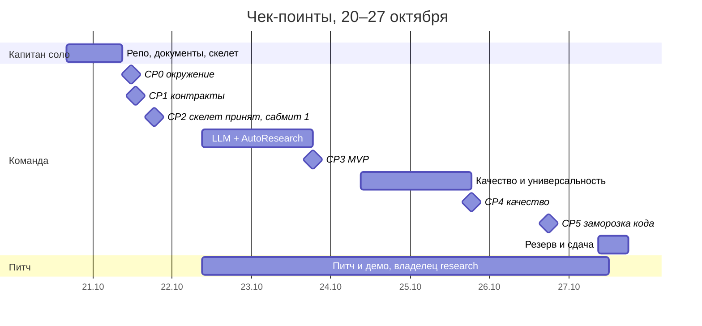

# Чек-поинты: от окружения до сдачи

Дедлайн принят как **27.10** ⚠️ (уточнить точное время у организаторов). На доске каждый чек-поинт — это milestone; задачи из ролевых чек-листов привязаны к ним.

| CP | Когда | «Сделано», если | Отвечает | Участвуют | Как проверяем |
|---|---|---|---|---|---|
| **CP0** Окружение | 21.10, 11:30 | у каждого `doctor.py --role <роль>` — всё ✅; L0-задача сделана (первый PR в `dev`) | qa | все | вывод doctor в issue «CP0», галочки на доске |
| **CP1** Контракты | черновик 20.10; утверждение 21.10, 13:00 | `interfaces/` v1 одобрен всеми владельцами; `tests/contracts` зелёные; тег `contracts-v1` | captain | владельцы модулей | 30-минутная встреча + approve PR от каждого |
| **CP2** Ходячий скелет | собран 20.10; принят 21.10, 18:30 | `solution.py` проходит от `task.md` до валидного `submission.csv` на 2 публичных и тренировочных задачах; сабмит №1 отправлен | captain | qa | CI зелёный, `scripts/run_local.py`, запись в `docs/submissions.md` |
| **CP3** MVP | 23.10, 18:30 | реальная LLM разбирает `task.md` и предлагает гипотезы; в цикле ≥ 5 проверенных гипотез; бюджеты времени/RAM/₽ соблюдаются; локально лучше простого бейзлайна на всех задачах | agent | ml, qa | харнесс + сабмит |
| **CP4** Качество | 25.10, 18:30 | playbook ≥ 10 гипотез, ≥ 2 типа моделей, ансамбль; реестр метрик покрывает тренировочные задачи; агент выдерживает «кривые» `task.md`, пропуски, большие данные; полный 3-часовой прогон на 4 ядрах/16 ГБ (Codespaces) без падений | ml + research | все | генеральная репетиция, отчёт qa |
| **CP5** Заморозка | код — 26.10, 18:00; сдача — 27.10 | после заморозки только багфиксы; финальный zip — лучший на public; README, слайды, демо-видео готовы, питч отрепетирован | captain (код), research (питч) | все | чек-лист релиза ниже, прогон питча |

## Сабмиты (≈ 21 на всё время)

| День | Сабмитов | Зачем |
|---|---|---|
| 21.10 | 1 | скелет: проверить формат и получить первую точку public |
| 22–25.10 | 2–3 в день | каждый — заметное улучшение по локальному харнессу |
| 26.10 | 2 | кандидаты в финал |
| 27.10 | 1–2 | резерв |

Перед каждым сабмитом:
1. PR `dev → main` слит капитаном, CI зелёный.
2. `uv run python scripts/package_submission.py` → `dist/submission-<дата>.zip` — в корне **только** `solution.py` и `requirements.txt` (платформа копирует лишь корневые `.py`; см. `reference/platform_instructions.md`). **Никогда не собирать zip руками.**
3. `uv run pytest tests/smoke/test_package.py` — запуск «как на платформе»; полный прогон на всех задачах — `scripts/pre_submit.py` (задача QA Q-L1-2).
4. Тег: `git tag sub-2026-10-21-1 origin/main && git push origin sub-2026-10-21-1`.
5. Загрузка на платформу, строка в [docs/submissions.md](submissions.md) — локальный скор рядом с public.

## Чек-лист релиза (CP5)

- [ ] Финальная версия — та, что дала лучший public, и в ней нет ничего «под публичные задачи»
- [ ] Прогон на тренировочных задачах не хуже предыдущего релиза
- [ ] Полный 3-часовой прогон без падений и с запасом по памяти
- [ ] `docs/experiments.md` и `docs/decisions/` дописаны
- [ ] README обновлён для жюри: что сделали, как устроено, результаты
- [ ] Слайды и демо-видео в `docs/pitch/`
