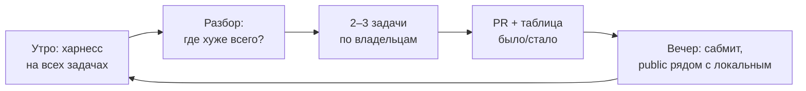

# Финишная прямая: 22–27 октября

Инструкция для всей команды: как работаем последние дни и что делает каждая роль.
Чек-поинты и даты — [checkpoints.md](checkpoints.md), ритм дня и дежурства — [team-process.md](team-process.md).

## 1. Главная идея: «обучение агента» = цикл «прогнали → нашли → починили»

Qwen мы не дообучаем. «Обучить агента» значит **прогнать его на задачах, найти, где он слаб, и починить это** в промптах, playbook, валидации, моделях. Поэтому мы не делим команду на «обучающих» и «доделывающих»: **все работают в одном цикле, каждый чинит свою папку**, а что именно чинить, решают цифры харнесса.

Почему так:
- до дедлайна 5 дней; «сначала всё доделать» не кончится никогда, а без прогонов непонятно, что важно;
- проблемы, которые находит прогон, почти всегда лежат в чужой папке (валидация — `ml/`, задачи — `research/`, метрики — `evaluation/`), поэтому чинить должны все;
- скрытые задачи неизвестны: единственная защита — проверять каждое изменение на **всех** задачах, включая `tasks/practice/`.

## 2. Правила для всех

1. **Изменение качества принимаем только с цифрами.** В PR — таблица «было/стало» из харнесса минимум на 4 задачах. Помогло на одной публичной и навредило на тренировочной → не берём.
2. **Никаких подгонок под публичные задачи.** Здания и атаки на private не будет. Если идея звучит как «для этих данных…» — это хак.
3. **Не ломаем то, что работает.** Агент всегда должен оставлять валидный `submission.csv`. Любая новая логика — под `try/except` → `ExperimentResult(status=FAILED)`.
4. **Каждый эксперимент — строка в [experiments.md](experiments.md)**, даже неудачный (скилл `experiment-log`). Это же материал для питча.
5. **Каждый сабмит — строка в [submissions.md](submissions.md)** с локальным скором рядом с public. Без этого мы не узнаем, можно ли верить своей валидации.
6. **Застрял больше 30 минут — пиши в чат**: «Делаю … / Пробовал … / Ошибка …».
7. **Заморозка кода — 26.10 в 18:00.** После — только багфиксы с меткой `hotfix`.

## 3. Распорядок дня

| Время | Что | Кто |
|---|---|---|
| 10:00 | Стендап + **таблица харнесса за ночь/утро**: на какой задаче агент хуже всего и почему | все, данные приносит qa |
| 10:15 | Каждый берёт 1–2 задачи из разбора (в свою папку) | все |
| 13:00 | Синк: что слито, что застряло; ревью PR друг друга | все |
| 18:30 | Решение о сабмите — ведёт дежурный дня (таблица в team-process.md) | все |
| 19:00 | Сабмит, строки в журналы, ретро 5 минут | дежурный + все |

## 4. Команды, которые нужны всем

| Что | Команда |
|---|---|
| Быстрый харнесс (≈ минута на задачу, урезанные данные) | `uv run python -m evaluation.harness --all --minutes 1 --rows 5000` |
| Нормальный харнесс | `uv run python -m evaluation.harness --all --minutes 5` |
| Одна задача | `uv run python -m evaluation.harness --task tasks/public/regression/task.md --minutes 10` |
| Сравнить два прогона | `uv run python scripts/harness_compare.py base.csv head.csv --out comment.md` |
| Агент без LLM (не тратит ₽) | `uv run python scripts/run_local.py --all --minutes 5 --mock-llm` |
| Проверка перед PR | `/pre-pr` в Claude Code или `uv run ruff check . && uv run pytest` |
| Проверка «как на платформе» | `uv run python scripts/pre_submit.py` |

Результаты харнесса копятся в `runs/harness/leaderboard.csv`. Балл в нём — по формуле организаторов, но **относительно тривиального ответа**, поэтому он завышен по сравнению с платформой (см. задачу qa №2).

---

## 5. Роли

### 👑 Капитан / интегратор — vasya (@thenlaooo)

**Цель:** каждый день в `main` лежит рабочая версия, сабмиты уходят по плану, 3-часовой запуск не падает.

| # | Задача | Готово, когда |
|---|---|---|
| 1 | **Сабмиты каждый день** (2–3 штуки), загрузка zip от дежурного | строка в `submissions.md` на каждый сабмит, public вписан |
| 2 | **Распределение 3 часов** между этапами (C-L2-2): бейзлайн → playbook → LLM → финальное обучение; запас на финал | в логе 3-часового прогона видно, что финальное обучение и запись ответа успели с запасом ≥ 10 мин |
| 3 | **Сторож последней минуты** (C-L3-1): если время кончается, лучший ответ уже записан | тест/прогон с урезанным бюджетом: ответ валиден при убийстве процесса в любой момент |
| 4 | **Песочница для кода LLM** (C-L2-1) — только если agent реально берёт A-L3-1 | иначе отложить: это риск, а не обязательная фича |
| 5 | Заморозка 26.10 18:00 и финальный выбор версии (C-L3-2) | чек-лист релиза в checkpoints.md закрыт |

**Не делать:** не брать на себя чужие модули «быстрее сам сделаю» — капитан и так узкое место.

### 🤖 LLM / agent-инженер — artem (@n0h4ndy)

**Цель:** LLM предлагает **разные и полезные** гипотезы и не тратит время впустую.

| # | Задача | Готово, когда |
|---|---|---|
| 1 | **Прогоны с настоящим Qwen на всех задачах** (с `LLM_CACHE_DIR` и `LLM_RUB_LIMIT`) и разбор логов: какие гипотезы повторяются, какие падают, сколько времени уходит на запросы | короткий отчёт в `experiments.md`: доля полезных гипотез, частые ошибки |
| 2 | **Разнородность пачки:** LLM не должна повторять совет из предупреждений профиля (2 из 3 гипотез про log1p) — давать в промпт историю и запрещать повторы направлений | на 3 задачах в пачке нет двух гипотез одного вида |
| 3 | **Использовать сильные находки ml в промпте:** xgboost, `proba_weights` под Macro F1, `balanced` — чтобы LLM знала, что уже сработало | гипотезы LLM опираются на историю, а не начинают с нуля |
| 4 | **Цикл после смены схемы валидации:** когда ml добавит group/time-схемы, `loop.py` выбирает схему до цикла и сравнивает только внутри неё (ADR 0008, D1) | тест: результат другой схемы не «побеждает» бейзлайн |
| 5 | Поведение без LLM / при таймаутах Qwen: агент молча переходит на playbook | прогон с недоступным `OPENAI_BASE_URL` даёт ответ не хуже mock-режима |
| 6 | (если останется время) A-L3-2 — роли аналитик/генератор/критик | только при выигрыше по харнессу |

**Не делать:** не писать промпты, которые упоминают конкретные колонки или домены публичных задач.

### 📊 ML-pipeline инженер — danil (@marenkov17)

**Цель:** агент честно оценивает себя и умеет сильные модели. Сейчас это **главный рычаг качества**.

| # | Задача | Готово, когда |
|---|---|---|
| 1 | **Схемы валидации (M-L2-1).** `ml/experiment.py::_split` знает только KFold/StratifiedKFold, а поле `ExperimentResult.validation` уже есть. Добавить `group(колонка)` и `time(колонка)`, выбирать схему **по `DataProfile`** (есть колонка времени, по которой test позже train → time; много повторов сущности → group) | на `public/regression` CV-скор близок к честному (сейчас KFold оптимистичнее на ~5 RMSE); решение по умолчанию — в `docs/decisions/` |
| 2 | **Optuna на честной схеме** (#29) — после п. 1 вернуть подбор агенту | на честной отложенной части Optuna не хуже бейзлайна |
| 3 | **Ансамбль по OOF (M-L3-1):** среднее/взвешенное лучших 2–3 моделей | выигрыш больше шума (t ≥ 2 по правилу ADR 0011) на ≥ 2 задачах |
| 4 | **xgboost и `proba_weights` в playbook** — вместе с research, после проверки на честной части | строка в `experiments.md` с честным скором |
| 5 | **Время и память** на больших данных: прикинуть, что будет с train в 1–5 млн строк (сэмплирование для поиска, `n_jobs`, типы `float32`) | прогон на синтетической большой задаче укладывается в бюджет, RAM < 24 ГБ |

**Не делать:** не принимать улучшения «по KFold» на задачах с повторами/временем — именно так Optuna стала честно хуже.

### 🔬 Исследователь / Data Scientist — roma (@Richi-Marqez)

**Цель:** у нас есть честная мерка и разнообразные задачи, а у жюри — понятный питч.

| # | Задача | Готово, когда |
|---|---|---|
| 1 | **Какая валидация предсказывает public (R-L2-1)** — правила выбора схемы по признакам данных, которые реализует ml (п. 1 у ml) | правило записано в `docs/research/` и согласовано с danil |
| 2 | **Ещё 3–5 тренировочных задач** в `tasks/practice/`, непохожих на текущие: большая (≥ 500k строк), с датами и временным test, с редкими классами, с текстовыми/высококардинальными категориями, с «кривым» `task.md`, с необычной метрикой | задачи проходят харнесс; ответы в `_answers/` |
| 3 | **Playbook v2:** перепроверить порядок гипотез на всех задачах на честной части, добавить xgboost/ансамбль, выкинуть то, что честно не помогает | стенд `research/bench_playbook.py` зелёный, таблица в `docs/research/` |
| 4 | **Питч (R-L3-1):** с 24.10 — каркас слайдов; материалы — `experiments.md`, ADR, график «CV vs честно» | слайды и демо-видео в `docs/pitch/` к 26.10, репетиция 27.10 |

**Не делать:** не добавлять в playbook гипотезы, которые помогают только на одной публичной задаче.

### 🧪 QA / MLOps — egor (@dzigoku-ku)

**Цель:** команда каждое утро видит честную таблицу «как агент работает на всех задачах», а сабмиты никогда не ломаются.

| # | Задача | Готово, когда |
|---|---|---|
| 1 | **Утренний харнесс** на всех задачах (`public` + `practice`) и таблица в чат к 10:00; сравнение с прошлым релизом | таблица есть каждый день, лидерборд не теряется |
| 2 | **Калибровка локального балла.** В `evaluation/local_score.py` бейзлайн — тривиальный ответ, у организаторов он сильнее. По каждому public восстановить бейзлайн организаторов: регрессия `B = RMSE / (1 − S/100)`, Macro F1 `B = (F1 − S/100) / (1 − S/100)` ⚠️ (верно, если public считается ровно по формуле из PDF; проверить на 2–3 сабмитах). Добавить в харнесс второй бейзлайн, близкий к организаторскому (например, LightGBM по умолчанию) | в лидерборде есть «балл как на платформе», и он сходится с public в пределах нескольких пунктов |
| 3 | **Тесты на устойчивость (Q-L2-1):** пустые колонки, все NaN, один класс в фолде, id не первым столбцом, кривой `task.md`, test без каких-то колонок | агент на каждом случае оставляет валидный ответ |
| 4 | **Генеральная репетиция 3 часа (Q-L2-2)** с ограничением 8 CPU / 32 ГБ (Docker `--cpus 8 --memory 32g` или Codespaces) | отчёт: пик RAM, время этапов, без падений — до 25.10 18:30 |
| 5 | **Отчёт харнесса в каждом PR (Q-L3-1)** — `harness-pr.yml` + `scripts/harness_compare.py` | у PR в `agent/` и `ml/` есть автоматическая таблица было/стало |
| 6 | **Финальная проверка релиза (Q-L3-2)** — `pre_submit.py` на финальном zip | ✅ во всех пунктах перед каждым сабмитом |

**Не делать:** не чинить баги в чужих модулях самому — написать воспроизводящий тест и отдать владельцу.

---

## 6. План по дням

| День | Цель дня | Дежурный |
|---|---|---|
| **22.10** | Первый сабмит ✅; первая утренняя таблица харнесса; ml начинает схемы валидации; research — новые задачи | artem |
| **23.10** | **CP3 MVP (18:30):** LLM в цикле, ≥ 5 проверенных гипотез, лучше бейзлайна на всех задачах; калибровка балла по 2–3 public | egor |
| **24.10** | Group/time-валидация в агенте; playbook v2; тесты устойчивости; каркас питча | danil |
| **25.10** | **CP4 (18:30):** ансамбль, генеральная репетиция 3 часа без падений | roma |
| **26.10** | Только полировка по харнессу; **заморозка 18:00**; 2 кандидата в финал | vasya |
| **27.10** | Резерв, финальный сабмит (версия с лучшим public, без хаков), питч | все |

## 7. Чего не делаем

- Не начинаем новые большие фичи после 25.10.
- Не принимаем улучшения без таблицы харнесса.
- Не тратим сабмиты «просто посмотреть» — каждый должен проверять конкретную гипотезу о качестве.
- Не трогаем `interfaces/` без `/sync-check` и процесса из CONTRIBUTING.md.
- Не подгоняем ничего под публичные задачи.
