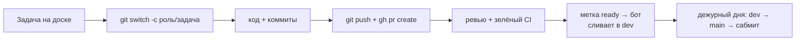

# Git и GitHub в нашем репозитории (пункт 3.2)

Команды одинаковые на Windows (PowerShell), macOS и Linux. Правила — в [CONTRIBUTING.md](../CONTRIBUTING.md).
В Claude Code можно просто попросить: «создай ветку под задачу #12», «открой PR» — он знает эти правила.



---

## 1. Взять задачу

1. Открой доску: https://github.com/orgs/alfahack-ilove4fak/projects (проект «Альфа Хак»).
2. Выбери задачу своей роли из колонки **Todo**, назначь себя (**Assignees → себя**) и перетащи в **In progress**.

Из терминала то же самое: `gh issue list --label role:ml` → `gh issue edit 12 --add-assignee @me`.

## 2. Создать ветку задачи

```
git switch dev
git pull
git switch -c ml/catboost
```
→ Должно появиться: `Switched to a new branch 'ml/catboost'`.
→ Если `error: Your local changes would be overwritten`: у тебя несохранённые изменения. Сохрани их: `git stash`, после создания ветки верни: `git stash pop`.

Имя ветки: `<роль>/<коротко-о-задаче>` латиницей через дефис.

## 3. Закоммитить

```
git status
git add ml/models.py tests/unit/test_models.py
git commit -m "feat: добавить CatBoost в реестр моделей"
```
→ `git status` показывает красным изменённые файлы; после `add` — зелёным; после `commit` — `1 file changed`.
→ Если `Please tell me who you are`: не настроен git (docs/install.md, шаг 1).

Совет: `git add .` добавляет ВСЁ — перед этим посмотри `git status`, чтобы не закоммитить лишнего. `.env` защищён `.gitignore`.

## 4. Отправить и открыть Pull Request

```
git push -u origin ml/catboost
gh pr create --base dev --fill --reviewer <ник-ревьюера>
```
→ Должна появиться ссылка `https://github.com/alfahack-ilove4fak/alfahack-automl/pull/N`. Открой её и заполни шаблон.
→ Ревьюера бот назначит сам (по таблице в CONTRIBUTING.md, раздел 2); одобрить может любой коллега.
→ Когда PR готов, поставь метку `ready`: `gh pr edit <номер> --add-label ready`.
→ Если `⛔ pre-push остановил пуш`: ты пытаешься пушить в `dev`/`main`. Создай ветку (шаг 2) и пушь её.

Чтобы задача на доске закрылась сама, напиши в описании PR: `Closes #12`.

## 5. Подтянуть свежие изменения из `dev`

Делай утром и перед открытием PR:
```
git fetch origin
git merge origin/dev
```
→ `Already up to date.` или `Merge made by ...` — всё хорошо.
→ `CONFLICT` — см. следующий шаг.

## 6. Решить конфликт

Конфликт = вы с коллегой поменяли одни и те же строки. Git просит выбрать.
1. `git status` → файлы в разделе `both modified`.
2. Открой файл. Ищи блоки:
   ```
   <<<<<<< HEAD
   твой вариант
   =======
   вариант из dev
   >>>>>>> origin/dev
   ```
   Оставь правильный код (иногда — оба куска), удали строки `<<<<<<<`, `=======`, `>>>>>>>`. В VS Code есть кнопки «Accept Current / Incoming / Both».
3. `git add <файл>` → `git commit` (сообщение уже подставлено) → `uv run pytest`.
4. Не уверен, чей вариант верный — **спроси автора** второго изменения (`git log origin/dev -- <файл>` покажет, кто это).

Сдаться и вернуть как было до merge: `git merge --abort`.

## 7. Посмотреть чужую ветку

```
git fetch origin
git branch -r
git switch agent/llm-hypotheses
```
→ `git branch -r` показывает все ветки на GitHub; `git switch` создаёт локальную копию и переключает на неё.
Вернуться к себе: `git switch ml/catboost`. Или в браузере: вкладка **Code → выбор ветки**.

## 8. Запустить у себя код коллеги

Удобнее всего через номер PR:
```
gh pr checkout 15
uv sync
uv run pytest
uv run python solution.py tasks/public/regression/task.md
```
→ `gh pr checkout` переключает на ветку PR; `uv sync` доставит библиотеки, если коллега их добавил.
Не забудь вернуться в свою ветку: `git switch <твоя-ветка>`.

## 9. Оставить ревью

1. Открой PR в браузере → вкладка **Files changed**.
2. Наведи на строку → **+** → комментарий. Пиши конкретно: что не так и как лучше.
3. **Review changes** → `Approve` (можно сливать) / `Request changes` (надо исправить) / `Comment`.

Из терминала:
```
gh pr diff 15
gh pr review 15 --approve -b "Проверил локально, тесты зелёные"
gh pr review 15 --request-changes -b "Нет теста на пустой test.csv"
```
Что проверять: решает ли задачу; есть ли тест; не меняет ли чужие модули и `interfaces/` без согласования; нет ли ключей и лишних файлов. В Claude Code: «отревьюй PR 15» запускает сабагента `code-reviewer`.

## 10. Забрать нужное из чужой ветки

| Что нужно | Команда |
|---|---|
| Один коммит целиком | `git cherry-pick <хеш>` (хеш — из `git log origin/ветка`) |
| Один файл в версии коллеги | `git restore --source origin/agent/llm-hypotheses -- agent/prompts.py` |
| Всё, что сделал коллега | лучше дождаться его PR в `dev` и сделать `git merge origin/dev` |

Перед этим предупреди автора — вдруг этот код ещё сырой.

## 11. Как не сломать чужую работу

- Меняешь только свою папку (см. `.github/CODEOWNERS`). Нужно поменять чужое — напиши владельцу.
- `interfaces/` — только по процессу из CONTRIBUTING.md, раздел 5. В Claude Code: `/sync-check`.
- Никаких `git push --force` (хук не пустит) и `git reset --hard` на общих ветках.
- Перед PR — `uv run pytest`: тесты проверяют контракты всех модулей.
- Маленькие PR и частые слияния → меньше конфликтов.

## 12. Слияние

Сливать самому не нужно: поставь метку `ready` (`gh pr edit 15 --add-label ready`). Раз в 30 минут бот проверяет, что есть одобрение (одно, а для `interfaces/`, `.github/`, `.claude/`, `.githooks/`, `solution.py` — два), CI зелёный, конфликтов нет, ветка не отстала от `dev`, и сливает PR (Squash). Причину задержки он пишет комментарием в PR.
- Срочно: метка `hotfix` — бот сольёт сразу, как только есть одобрение и зелёный CI.
- Подожди: метка `wait` — бот не трогает.
- Бот обновил твою ветку (подтянул свежий `dev`) — сделай `git pull`, прежде чем пушить дальше.
- `dev → main` (релиз) сливает дежурный дня.

## 13. Личная ветка `team/<имя>`

Там лежит твой `START_HERE.md`; можно вести заметки. **В `dev` её не сливаем.**
```
git switch team/ivan
# правки заметок
git commit -am "docs: заметки"
git push
```

## 14. Спасательный круг

| Ситуация | Что делать |
|---|---|
| Закоммитил в `dev` локально (пуш не прошёл) | `git switch -c роль/задача` (коммит переедет с тобой), затем `git switch dev && git reset --hard origin/dev` |
| Отменить последний коммит (ещё не запушен), сохранив изменения | `git reset --soft HEAD~1` |
| Выбросить свои незакоммиченные правки в файле | `git restore <файл>` |
| «Я всё сломал» | `git status` + скрин в чат. Ничего не удаляй — почти всё в git можно вернуть |
