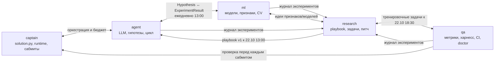

# Как мы работаем вместе (живой буткемп, полный день)

## Ритм дня

| Время | Что | Сколько | Кто |
|---|---|---|---|
| 10:00 | **Стендап** у доски: вчера / сегодня / блокер | 15 мин | все |
| 13:00 | **Синк 1**: смотрим, что бот слил и что застряло; прогоняем харнесс | 30 мин | все |
| 16:00 | **Синк по контрактам** — только если кто-то меняет `interfaces/` | 10 мин | затронутые владельцы |
| 18:30 | **Синк 2** + решение: сабмитим ли сегодня и что | 30 мин | все, ведёт дежурный дня |
| 19:00 | Сабмит, записи в журналы, **ретро-минутка**: что мешало, что поменять | 15 мин | все |

PR сливает **бот** — на событиях PR и в окна интеграции (13:00, 18:30, 19:00 МСК): метка `ready`, одно одобрение, зелёный CI. Срочное — метка `hotfix`. Никто никого не просит слить, а `dev` защищён тестами.

## Правила

1. **Застрял больше 30 минут — пиши в чат.** Шаблон: «Делаю … / Пробовал … / Ошибка … (лог или скрин)». Или подойди к соседу — мы в одной комнате.
2. **Чужой модуль — только через владельца.** Кто чем владеет — `.github/CODEOWNERS`.
3. **Контракт (`interfaces/`) меняем по процессу**: `/sync-check` → сообщение в чат → PR → два одобрения (звать затронутых владельцев) → сливает бот; CI проверяет версию и CHANGELOG.
4. **Каждый эксперимент — в журнал** [docs/experiments.md](experiments.md), каждое важное решение — в [docs/decisions/](decisions/). Это память команды и материал для питча.
5. **Сабмит — только из тега на `main`** и только после проверок (docs/checkpoints.md).
6. **Ключи — только в `.env`.** Никогда в чат, код и разговор с Claude.
7. **Бюджет LLM 600 ₽/день на всех — только на время разработки** (на платформе лимита на токены нет). Реальные вызовы — только с кэшем (`LLM_CACHE_DIR`) и лимитом (`LLM_RUB_LIMIT`). Для отладки — `LLM_MOCK=1`.

## Дежурный дня

Сабмитов 3 в день на всех, а «что отправляем» решает кто-то один. Чтобы не было постоянного начальника, дежурим **по очереди, по одному на день**.

Дежурный: ведёт синк в 18:30 (решение «сабмитим ли и какую версию» принимаем вместе, по журналу сабмитов и харнессу), открывает PR `dev → main` (ревью qa) и сливает его, ставит тег `sub-ГГГГ-ММ-ДД-N`, собирает zip (`scripts/package_submission.py`), записывает строку в `docs/submissions.md`. Если загружать на платформу технически может только аккаунт капитана, дежурный передаёт ему готовый zip, и тот загружает без обсуждений.

| День | Дежурный |
|---|---|
| 21.10 | vasya |
| 22.10 | artem |
| 23.10 | egor |
| 24.10 | danil |
| 25.10 | roma |
| 26.10 | vasya (заморозка кода в 18:00) |
| 27.10 | вся команда: финальная версия выбирается вместе |

Расписание предложено, правим на встрече: поменяться днями можно, предупредив в чате.

Сторож `guard.yml` отключён капитаном 21.10, поэтому слияние `dev → main` дежурный делает сам, без просьб к капитану.

## Кто с кем стыкуется

| Стыковка | Когда | Кто → кому | Что передаём |
|---|---|---|---|
| Контракты v1 | 21.10, 13:00 | captain → все | `interfaces/` на утверждение |
| Формат гипотез | 21.10 и далее ежедневно в 13:00 | agent ↔ ml | какие `params` понимает `run_experiment` |
| Playbook v1 | 22.10, 13:00 | research → agent | ≥ 10 универсальных гипотез |
| Тренировочные задачи | 22.10, 18:30 | research + qa → все | `tasks/practice/` с другими метриками |
| Реестр метрик | 22.10, 18:30 | qa → agent, ml | все метрики, которые могут встретиться |
| Проверка перед сабмитом | каждый вечер | qa → captain | отчёт pre_submit |
| Материал для питча | каждый вечер | все → research | строки в журнале экспериментов |

## Каналы

- **Telegram-чат команды** — вопросы, блокеры, «слил PR в dev».
- **GitHub Issues + доска** — задачи и баги. Всё, что дольше 30 минут работы, — issue.
- **Живьём** — стендап, синки, парная работа.
