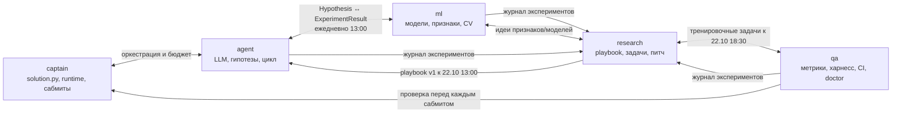

# Как мы работаем вместе (живой буткемп, полный день)

## Ритм дня

| Время | Что | Сколько | Кто |
|---|---|---|---|
| 10:00 | **Стендап** у доски: вчера / сегодня / блокер | 15 мин | все |
| 13:00 | **Окно интеграции 1**: сливаем готовые PR в `dev`, прогоняем тесты и харнесс | 30 мин | все, ведёт капитан |
| 16:00 | **Синк по контрактам** — только если кто-то меняет `interfaces/` | 10 мин | затронутые владельцы |
| 18:30 | **Окно интеграции 2** + решение: сабмитим ли сегодня и что | 30 мин | все |
| 19:00 | Сабмит, записи в журналы, **ретро-минутка**: что мешало, что поменять | 15 мин | все |

Вне окон PR не сливаем (кроме срочных багфиксов — с сообщением в чат). Так `dev` ломается реже, а если ломается — понятно, когда и чем.

## Правила

1. **Застрял больше 30 минут — пиши в чат.** Шаблон: «Делаю … / Пробовал … / Ошибка … (лог или скрин)». Или подойди к соседу — мы в одной комнате.
2. **Чужой модуль — только через владельца.** Кто чем владеет — `.github/CODEOWNERS`.
3. **Контракт (`interfaces/`) меняем по процессу**: `/sync-check` → сообщение в чат → PR → ревью владельцев → сливает капитан.
4. **Каждый эксперимент — в журнал** [docs/experiments.md](experiments.md), каждое важное решение — в [docs/decisions/](decisions/). Это память команды и материал для питча.
5. **Сабмит — только из тега на `main`** и только после проверок (docs/checkpoints.md).
6. **Ключи — только в `.env`.** Никогда в чат, код и разговор с Claude.
7. **Бюджет LLM 600 ₽/день на всех.** Реальные вызовы — только с кэшем (`LLM_CACHE_DIR`) и лимитом (`LLM_RUB_LIMIT`). Для отладки — `LLM_MOCK=1`.

## Кто с кем стыкуется

| Стыковка | Когда | Кто → кому | Что передаём |
|---|---|---|---|
| Контракты v1 | 21.10, 13:00 | captain → все | `interfaces/` на утверждение |
| Формат гипотез | 21.10 и далее ежедневно в 13:00 | agent ↔ ml | какие `params` понимает `run_experiment` |
| Playbook v1 | 22.10, 13:00 | research → agent | ≥ 10 универсальных гипотез |
| Тренировочные задачи | 22.10, 18:30 | research + qa → все | `tasks/practice/` с другими метриками |
| Реестр метрик | 22.10, 18:30 | qa → agent, ml | все метрики, которые могут встретиться |
| Проверка перед сабмитом | каждый вечер | qa → captain | отчёт pre_submit |
| Материал для питча | каждый вечер | все → research | строки в журнале экспериментов |

## Каналы

- **Telegram-чат команды** — вопросы, блокеры, «слил PR в dev».
- **GitHub Issues + доска** — задачи и баги. Всё, что дольше 30 минут работы, — issue.
- **Живьём** — стендап, окна интеграции, парная работа.
